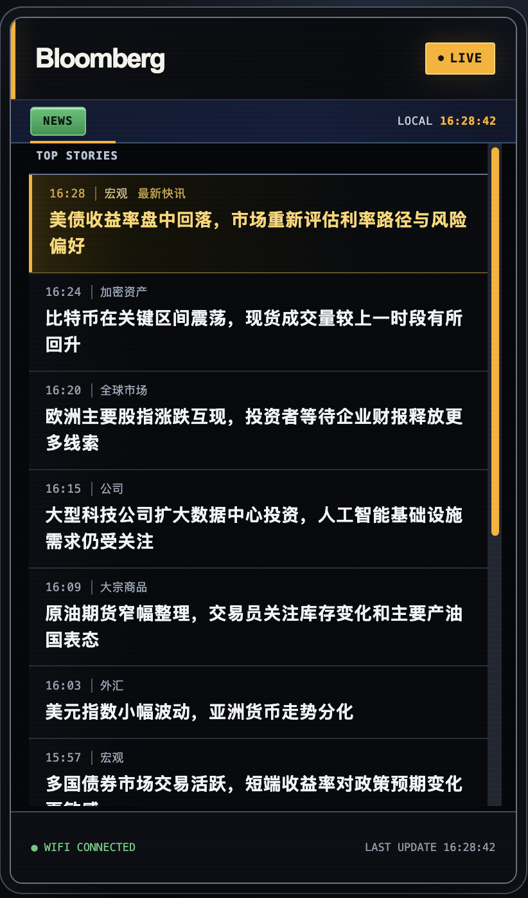

<div align="center">

# Bloomberg 风格财经快讯终端

**把实时财经快讯放到一块独立运行的 ESP32-P4 竖屏上。**

[](https://www.espressif.com/en/products/socs/esp32-p4)
[](https://docs.espressif.com/projects/esp-idf/en/v5.5.5/esp32p4/get-started/index.html)
[](https://lvgl.io/)
[](https://en.wikipedia.org/wiki/C_(programming_language))
[](#硬件)

</div>

---

## 效果预览



> 图片是界面示例。设备上的新闻标题和时间来自实时新闻源。

## 功能

- Bloomberg 终端风格的黑黄主题，竖屏显示，最新快讯高亮。
- ESP32 直接连接 Wi-Fi 获取新闻；不需要 Mac 常驻，也不依赖 USB 推送。
- WebSocket 接收实时推送，并用 HTTPS 快照定期校准和补漏。
- 列表支持触摸上下滚动；中文字体直接随固件提供。
- 网络短暂中断时保留当前显示，并自动重连、恢复同步。
- 采用 180° 安装方向的屏幕与触摸映射，适合将 USB-C 供电口朝上放置。

## 硬件

- Waveshare ESP32-P4 7 英寸触摸屏开发板（600 × 1024 竖屏版，板载 Wi-Fi 协处理器）
- USB-C 数据线，用于首次刷写和串口查看；刷写后可改用稳定的 5V 电源
- 可访问互联网的 Wi-Fi 网络

> 项目针对上述板卡的 LCD、触摸和 Wi-Fi 硬件编写。其他 ESP32 或屏幕需要移植板级驱动，不能保证直接运行。

## 快速开始

### 1. 安装开发环境

安装 Espressif ESP-IDF **v5.5.5**，并按官方安装说明配置 Python、工具链和 ESP-IDF Component Manager：

- [macOS / Linux 安装指南](https://docs.espressif.com/projects/esp-idf/en/v5.5.5/esp32p4/get-started/index.html)
- [Windows 安装指南](https://docs.espressif.com/projects/esp-idf/en/v5.5.5/esp32p4/get-started/windows-setup.html)

打开 ESP-IDF 终端，然后克隆项目：

```bash
git clone https://github.com/<你的用户名>/bloomberg-news-terminal.git
cd bloomberg-news-terminal
```

### 2. 配置 Wi-Fi

```bash
idf.py set-target esp32p4
idf.py menuconfig
```

在菜单中打开 **财经快讯终端**，填写 Wi-Fi 名称和密码，保存并退出。Wi-Fi 密码保存在本机的 `sdkconfig`，该文件已加入 `.gitignore`，不会随项目提交。

设备若已保存过可用的网络凭据，可以把这两项留空，固件会沿用设备现有配置。新设备首次刷写时，若板上已有其他固件的 NVS 数据且连接到了旧网络，可先备份需要的数据，再运行 `idf.py erase-flash` 清空整片 Flash；这会删除设备上原有应用与设置。

### 3. 编译和刷写

```bash
idf.py build
idf.py -p /dev/cu.usbmodemXXXX flash monitor
```

macOS 下可先用 `ls /dev/cu.usb*` 查看串口；Linux 常见设备名为 `/dev/ttyACM0`，Windows 通常为 `COM3`。将命令中的端口替换为实际端口。

ESP-IDF Component Manager 会根据 `main/idf_component.yml` 下载板卡驱动和 LVGL 等依赖；首次构建需要联网。`dependencies.lock` 锁定组件解析结果。编译完成后，断开电脑并使用稳定的 5V 电源即可独立运行。

## 新闻同步原理

启动后，设备先通过 HTTPS 拉取最新快讯快照，再连接新闻源的 WebSocket 实时频道。固件每隔一段时间还会重新拉取快照，修正断线期间遗漏的新闻；当实时连接失效时自动重连。所有网络请求都由 ESP32 发起，新闻标题缓存在 RAM 中，不写入 Flash。

当前数据来自华尔街见闻网页使用的接口。它不是面向第三方开发者承诺稳定的公开 API；如果网站修改接口或访问策略，可能需要更新固件。此项目是个人项目，与 Bloomberg 或华尔街见闻无官方关联。

## 项目结构

```text
├── assets/                  # README 预览图
├── main/                    # 应用、新闻同步、UI 和内置中文字形
│   ├── Kconfig.projbuild    # 本地 Wi-Fi 设置项
│   ├── idf_component.yml    # ESP-IDF 组件依赖
│   └── NEWS-FONT-LICENSE.txt
├── partitions.csv           # ESP32-P4 分区表
├── sdkconfig.defaults       # 板卡和 LVGL 默认配置
└── dependencies.lock        # 组件依赖锁定文件
```

## 许可与商标

本项目目前尚未声明顶层软件许可证；克隆和个人使用不受影响，但在再分发或贡献代码前请先确认项目许可证。内置中文字体基于 Adobe Source Han Sans，字体许可见 [`main/NEWS-FONT-LICENSE.txt`](main/NEWS-FONT-LICENSE.txt)。ESP-IDF 下载的组件各自遵循其上游许可证。

“Bloomberg”仅用于描述视觉风格，不代表 Bloomberg L.P. 背书、赞助或关联；本项目不包含 Bloomberg 商标图片或官方资产。
